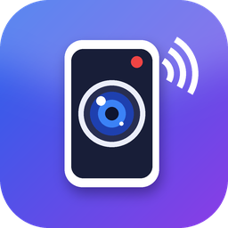
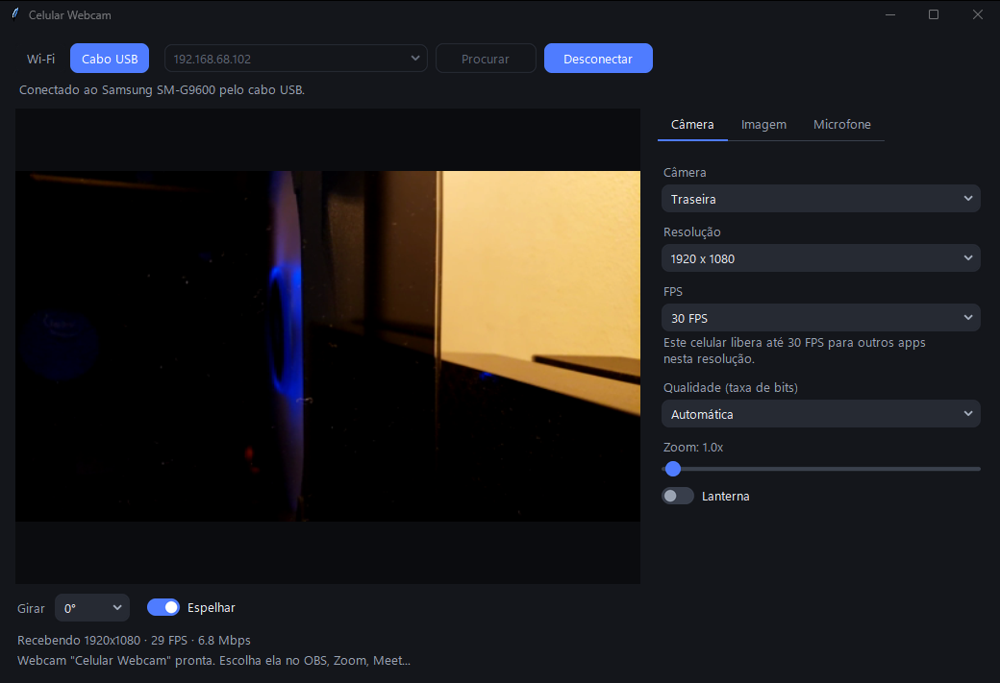

<p align="center">
  
</p>

<h1 align="center">Celular Webcam</h1>

<p align="center">
  Use a câmera do seu celular Android como webcam no PC, pelo Wi-Fi ou pelo cabo USB.<br>
  Grátis, sem OBS e sem anúncios. E todos os ajustes da câmera ficam no PC.
</p>

<p align="center">
  <a href="../../releases/latest"><b>Baixar a última versão</b></a>
</p>



## O que é

O Celular Webcam faz o Windows enxergar o seu celular como uma webcam de verdade. O PC ganha uma câmera chamada **"Celular Webcam"**, que qualquer programa de vídeo pode escolher na lista de câmeras, como OBS, Zoom, Meet, Teams e Discord.

São duas partes que trabalham juntas: um app no celular e um programa no PC. Depois de conectar, você não precisa mais encostar no celular:

- **Todos os ajustes são feitos pelo PC:** zoom, brilho, foco, balanço de branco, ISO, obturador, lanterna, resolução, FPS e qualidade.
- **Funciona com o celular bloqueado:** a tela apaga, a bateria dura mais e o vídeo continua.
- **Funciona pelo Wi-Fi ou pelo cabo USB.**
- **Serve para celulares antigos:** roda a partir do Android 6 e mostra só os ajustes que a câmera do aparelho aceita.
- **Microfone do celular:** o som também pode ir para o PC.
- **Não atrapalha:** ao minimizar, o programa fica nos itens ocultos da barra de tarefas.

## Como usar

**Você vai precisar de:** um celular com Android 6 ou mais novo e um PC com Windows 11 (22H2 ou mais novo).

1. Baixe os dois arquivos da [última versão](../../releases/latest).
2. No PC, rode o instalador `CelularWebcam-Instalador-x.y.z.exe`. Ele instala o programa e a webcam virtual de uma vez.
3. No celular, instale o `CelularWebcam-x.y.z.apk`. O Android vai pedir permissão para instalar de fora da loja.
4. Abra o app no celular e o programa no PC, e conecte de um destes jeitos:
   - **Wi-Fi:** com os dois na mesma rede, clique em **Procurar** e depois em **Conectar**.
   - **Cabo USB:** ative a **Depuração USB** no celular, escolha **Cabo USB** e clique em **Conectar**.
5. No seu programa de vídeo, escolha a câmera **"Celular Webcam"**.

Agora pode bloquear o celular. Para desligar tudo, use **Encerrar** no app ou na notificação.

### Avisos importantes

- **Alerta do Windows:** o instalador não tem assinatura digital paga, então o Windows mostra "Editor desconhecido" e o SmartScreen pode avisar na primeira vez. Para continuar, clique em **Mais informações** e depois em **Executar assim mesmo**. O código está todo aqui para quem quiser conferir.
- **Abra o app antes de bloquear:** o caminho garantido é abrir o app e conectar com o celular desbloqueado.
- **Bateria:** sem PC conectado, a câmera desliga, e depois de 10 minutos o app se encerra sozinho.
- **Microfone em outros programas:** o som do celular vai para uma saída de áudio do PC. Para aparecer como microfone no Zoom ou no Meet, instale um cabo de áudio virtual, como o [VB-CABLE](https://vb-audio.com/Cable/), que é gratuito.
- **60 FPS:** depende do que o fabricante libera para outros apps. O Galaxy S9, por exemplo, só libera 30 FPS. O app mostra o máximo do seu aparelho.

### O que já foi testado

Testado em um **Galaxy S9 com Android 10** e um PC com **Windows 11**, pelo cabo e pelo Wi-Fi, em 1080p a 30 FPS. O app foi escrito pensando em outros aparelhos, mas o projeto ainda é novo: se algo não funcionar no seu, [abra uma issue](../../issues) contando o modelo do celular.

## Como foi feito

**A ideia.** Os apps desse tipo costumam obrigar você a mexer no próprio celular para ajustar a imagem, o que não ajuda quando ele já está posicionado. Muitos também dependem do OBS ou de outros programas. A proposta aqui era outra: um app gratuito e independente, leve o bastante para celular antigo, com todos os ajustes no PC.

**Sem depender do OBS.** A primeira ideia era usar a câmera virtual do OBS. Em vez disso, o projeto ganhou uma câmera virtual própria, escrita em C++ com a API oficial do Windows 11, para quem instala não precisar de mais nada.

**O teste no celular de verdade.** Primeiro tudo foi validado com um celular simulado por um script. No aparelho real apareceu um defeito que o simulador não mostrava: o Android abria uma segunda cópia da tela do app, uma ficava com a câmera e a outra com a conexão, e o PC conectava na cópia sem imagem.

**A tentativa de 60 FPS.** O S9 só libera 60 FPS para outros apps pelo modo de câmera lenta. Nele o aparelho entrega 240 FPS, a imagem escurece e o encoder trava. Esse caminho foi descartado: hoje o app oferece 60 FPS onde o aparelho libera e informa o limite nos demais.

**Funcionar com a tela bloqueada.** No começo, câmera e conexão viviam dentro da tela do app, e por isso tudo parava ao bloquear. Essa parte foi movida para um serviço em primeiro plano. Agora a tela só mostra a prévia, e ela sai da captura sem reiniciar o encoder, então o vídeo segue sem o PC reconectar.

O projeto foi criado por uma pessoa que não programa no dia a dia, desenvolvendo em conversa com o [Claude Code](https://claude.com/claude-code), a IA de programação da Anthropic, e testando em um celular real a cada etapa.

## Como funciona por dentro

```
Celular (app Android)                         PC
 câmera → encoder H.264 do aparelho ──TCP──→ programa do PC
 ajustes ←─────────── JSON ←──────────────── janela de ajustes
                                              │ decodifica e ajusta ao tamanho pedido
                                              ▼
                                   memória compartilhada (NV12)
                                              ▼
                     câmera virtual, dentro do serviço de câmeras do Windows
                                              ▼
                                   OBS / Zoom / Meet / Teams...
```

- **Wi-Fi:** o PC acha o celular por broadcast UDP na porta 27184 e conecta na porta TCP 27183.
- **Cabo USB:** o `adb` cria um túnel para a mesma porta TCP.
- **Protocolo:** tipo (1 byte) + tamanho (4 bytes) + conteúdo. Tipo 1 é JSON (estado e ajustes), 3 é vídeo H.264 e 4 é áudio PCM de 48 kHz.
- **Sem criptografia:** a conexão não é criptografada nem tem senha, então use em uma rede em que você confia.

| Pasta | O que tem |
|---|---|
| `android/` | App do celular em Kotlin, com Camera2 e sem bibliotecas extras |
| `pc/` | Programa do PC em Python (Tkinter, PyAV) |
| `pc/vcam/` | Câmera virtual em C++ (`MFCreateVirtualCamera`) |
| `instalador/` | Gera o APK e o instalador (Inno Setup) |
| `icone/` | Ícone e o script que o gera |

## Compilar por conta própria

**App Android:** JDK 17 e Android SDK (`platforms;android-35`, `build-tools;34.0.0`).

```powershell
powershell -File android\compilar.ps1
```

Sem uma chave própria em `android/keystore/`, o app é assinado com a chave de debug. Por isso ele não instala por cima da versão oficial: desinstale a outra antes.

**Programa do PC:** Python 3.12 ou mais novo. Na primeira vez, o script prepara o ambiente sozinho.

```powershell
pc\iniciar.bat
```

**Câmera virtual:** Visual Studio Build Tools 2022 com C++ e o Windows 11 SDK.

```powershell
pc\vcam\compilar.bat
powershell -File pc\vcam\instalar-camera.ps1
```

**Modo cabo:** o programa procura o `adb` em `pc/adb/`, no PATH e no Android SDK.

**Versão completa:** com Inno Setup 6 e PyInstaller, `instalador\gerar-versao.ps1` gera o APK e o instalador.

## Licença

[MIT](LICENSE). Pode usar, modificar e distribuir à vontade.
